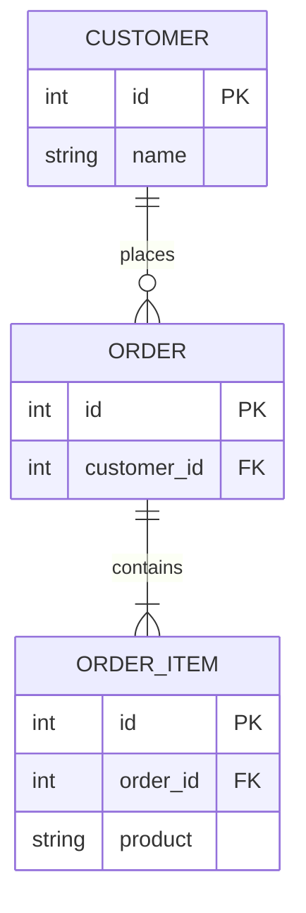
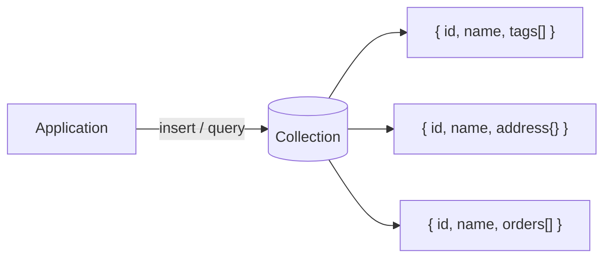
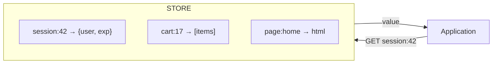
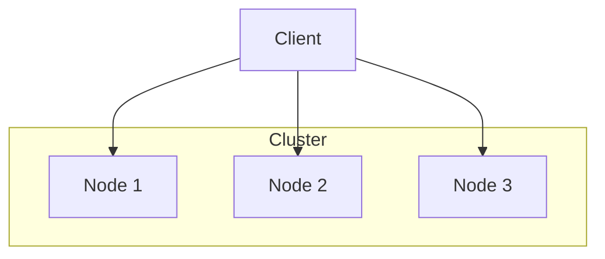
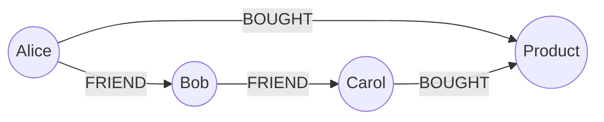
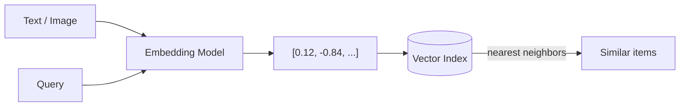

# What is a Database?

##  Overview

---

A **database** is one or more dedicated servers responsible for storing, organizing, protecting and retrieving data in a structured and reliable way. Instead of keeping information in loose files, applications delegate persistence to a database so data can be queried, updated and shared safely between many users and services at the same time.

Different problems require different ways of saving data. The main models are:

| Model | How it saves data | Examples | Best indicated for |
|---|---|---|---|
| **Relational (SQL)** | Tables with rows and columns, linked by keys | MySQL, PostgreSQL, SQL Server, Oracle, IBM Db2 | Security systems, ERPs and CRMs |
| **Document** | JSON documents with flexible structure | MongoDB | Records and catalogs whose format can change |
| **Key-Value** | One value for each key | Redis, DynamoDB | Cache, sessions and real-time applications |
| **Column** | Data organized by columns | Apache Cassandra, Apache HBase | Large volumes of data distributed across servers |
| **Graph** | Nodes and the relationships between them | Neo4j | Social media, recommendation and fraud detection |
| **Vector** | Numeric vectors (embeddings) searched by similarity | PgVector (PostgreSQL extension) | Semantic / AI search and RAG |

---

###  Introduction

A database is managed by a **Database Management System (DBMS)** — the software that sits between the application and the stored data. The DBMS handles how data is written to disk, how it is indexed for fast reads, how concurrent access is coordinated, and how the data survives crashes.

In a system design context, the database is usually the **source of truth**: the component that must not lose data and that every other component ultimately depends on. Because of that, choosing the right type of database — and understanding its guarantees — is one of the most important decisions in an architecture.

---

###  Why use it?

- **Persistence** — data survives application restarts, deploys and crashes.
- **Concurrency** — many users and services can read and write at the same time without corrupting data.
- **Integrity & reliability** — constraints, transactions and durability guarantees keep data consistent.
- **Efficient querying** — indexes and query engines return answers over huge datasets in milliseconds.
- **Security** — access control, authentication and encryption protect sensitive information.
- **Scalability** — replication and partitioning let storage grow with demand.

---

###  Types

####  Type 1 — Relational (SQL)

Stores data in tables of rows and columns with a fixed schema. Relationships between tables are expressed through primary and foreign keys, and operations are grouped into ACID transactions.

#####  How it works?



Data is normalized across related tables and linked by keys. Queries written in SQL join those tables on demand, and transactions guarantee that a group of changes either fully succeeds or is fully rolled back.

---

> **Analogy — a bank ledger.** Think of a money transfer of **$100** from Alice to Bob. The transaction does *two* writes: subtract 100 from Alice, add 100 to Bob. ACID means both happen or **neither** does — the bank can never lose or duplicate the $100, even if the server crashes mid-way.
>
> | Account | Before | After |
> |---|---|---|
> | Alice | $500 | $400 |
> | Bob | $200 | $300 |
>
> If the power fails right after debiting Alice, the whole transaction rolls back and Alice keeps her $500 — no money vanishes.

#####  Use Cases

- Financial and banking systems that require strong consistency.
- ERPs and CRMs with highly structured, interrelated data.
- Any domain where integrity and transactions are critical.

#####  Limitations

- Rigid schema makes frequent structural changes costly.
- Horizontal scaling (sharding) is harder than in NoSQL models.
- Complex joins can become slow at very large scale.

---

> **Scenario — the schema tax.** An online store on a single PostgreSQL node serves reads comfortably at ~**5,000 queries/sec**. Adding one new column to a 50-million-row `orders` table can lock or rewrite the table for **minutes**, and once a single server maxes out (say ~64 vCPUs), going further means sharding by hand — splitting customers A–M onto DB1 and N–Z onto DB2 — which an application-level cache or a document store would avoid.

####  Type 2 — Document

Stores data as self-contained JSON (or BSON) documents with a flexible structure, so each record can hold nested data and differ from the next.

#####  How it works?



Documents are grouped into collections. There is no enforced schema, so related data is embedded inside a single document instead of spread across joined tables, which makes reads of a whole entity fast.

---

> **Analogy — a folder of forms.** A relational order is a stapled packet spread across **4 filing cabinets** (customer, order, items, address) you must visit to assemble. A document is a **single folder** holding the whole order at once:
>
> ```json
> {
>   "id": 1, "customer": "Alice",
>   "address": { "city": "Lisbon" },
>   "items": [ { "product": "Book", "qty": 2 } ]
> }
> ```
>
> Loading an order page is **1 read** instead of a 4-table join — and if tomorrow some orders need a `giftMessage` field, you just add it to new documents; old ones stay valid with no migration.

#####  Use Cases

- Catalogs, user profiles and content whose shape evolves over time.
- Rapid prototyping where the data model is still changing.
- Semi-structured data that doesn't fit neat tables.

#####  Limitations

- Weaker support for complex multi-document transactions.
- Duplicated/embedded data can drift out of sync.
- Ad-hoc queries across documents can be less efficient than SQL joins.

---

> **Scenario — the sync trap.** Say you embed the customer's name inside every order to make reads fast. One customer with **2,000 past orders** changes their name — now you must update **2,000 documents** instead of one row in a `customers` table. "Flexible schema" also means *no* guard rail: a typo like `"quantiy": 2` is accepted silently, and the bug only surfaces later in a report.

####  Type 3 — Key-Value

The simplest model: every piece of data is stored and retrieved by a unique key, like a giant distributed hash map.

#####  How it works?



The application asks for a key and gets its value back directly, with no query planning. Because lookups are O(1) and data is often held in memory, reads and writes are extremely fast.

---

> **Analogy — a coat check.** You hand over your coat and get ticket **#42**; later you show #42 and get the exact coat back — no searching the racks. That's a key-value lookup.
>
> | | Key-Value (Redis) | Relational (disk) |
> |---|---|---|
> | Typical read | **< 1 ms** (RAM) | ~5–20 ms |
> | Throughput | **100k+ ops/sec** per node | thousands/sec |
>
> A login check that hits Postgres on every request might take 10 ms; cached in Redis under key `session:42` it returns in under 1 ms — roughly a **10×** speed-up.

#####  Use Cases

- Caching to relieve load on a primary database.
- Session storage and feature flags.
- Real-time leaderboards, counters and rate limiting.

#####  Limitations

- No rich querying — you must know the key.
- Not suited to complex relationships between records.
- In-memory stores are limited by available RAM.

---

> **Scenario — you can only ask by ticket number.** With the coat check you *cannot* ask "give me all the blue coats" — there's no index on color, only on the ticket. Likewise you can fetch `user:42` instantly but **cannot** query "all users in Lisbon" without scanning everything. And since data lives in RAM, storing **10 GB** of sessions needs ~10 GB of (expensive) memory, versus cheap disk on a relational DB.

####  Type 4 — Column

Stores data by columns rather than rows, and distributes it across many servers to handle enormous write and read volumes.

#####  How it works?



Rows are partitioned by a key and spread across nodes in a cluster, with no single master. Storing values of the same column together makes scans and aggregations over huge datasets very efficient.

---

> **Analogy — a spreadsheet read down the columns.** To compute "average temperature" over **1 billion** sensor readings, a row store must touch every full row (timestamp, sensor_id, location, value…). A column store reads **only the `value` column** off disk and skips the rest — often **10–100× less I/O** for analytics.
>
> | Reading stored by... | To average `value` you read |
> |---|---|
> | **Row** (SQL) | all 5 fields × 1B rows |
> | **Column** (Cassandra) | just the 1 `value` column |
>
> And because there's no single master, you scale by *adding machines*: 3 nodes → 6 nodes roughly **doubles** write capacity.

#####  Use Cases

- Time-series, logging and IoT data.
- Very high write throughput across distributed clusters.
- Analytics over massive volumes of data.

#####  Limitations

- Often favors availability over strong consistency (eventual consistency).
- Querying is driven by the partition key; ad-hoc queries are limited.
- More complex to model and operate than a single relational database.

---

> **Scenario — eventual consistency.** You write a sensor reading to node 1; a dashboard reading from node 3 **a few milliseconds later** might still see the old value until replicas sync — fine for metrics, dangerous for a bank balance. You also must design the table *around the query up front*: data partitioned by `sensor_id` answers "readings for sensor X" instantly, but "all readings in Lisbon" has no partition to use and forces a slow full-cluster scan.

####  Type 5 — Graph

Represents data as **nodes** (entities) connected by **edges** (relationships), making the connections themselves first-class, queryable data.

#####  How it works?



Instead of joining tables, the engine traverses edges directly from node to node. This makes questions like "friends of friends" or "paths between accounts" fast even when they span many hops.

---

> **Analogy — following a chain of handshakes.** "Friends of friends of friends" (3 hops) in SQL means **joining the friendships table to itself 3 times** — and cost explodes as the network grows. A graph just *walks the edges* from one person to the next.
>
> | Depth | SQL (self-joins) | Graph (edge walk) |
> |---|---|---|
> | 2 hops | slow | fast |
> | **5 hops** | often **seconds→timeout** | still **milliseconds** |
>
> In fraud, this is how you spot that 8 "unrelated" accounts all trace back to **one** shared phone number and card.

#####  Use Cases

- Social networks and relationship-heavy data.
- Recommendation engines.
- Fraud detection by spotting suspicious connection patterns.

#####  Limitations

- Less efficient for simple, tabular, aggregate workloads.
- Smaller ecosystem and steeper learning curve.
- Scaling very large graphs horizontally is challenging.

---

> **Scenario — wrong tool for totals.** Asking a graph for "total revenue this month" means visiting millions of nodes one edge at a time — a plain SQL `SUM()` over a column does it far faster. Graphs also resist sharding: splitting a tightly-connected **100-million-node** social graph across servers inevitably cuts edges that span machines, so many traversals pay a slow cross-network hop.

####  Type 6 — Vector

Stores data as high-dimensional numeric vectors (**embeddings**) and retrieves records by **similarity** rather than exact match.

#####  How it works?



Content is converted into vectors by an embedding model and stored in an index. A query is embedded the same way, and the database returns the nearest vectors — the items whose meaning is closest.

---

> **Analogy — search by meaning, not spelling.** A keyword search for "car" misses a document that only says "automobile". Embeddings place both near each other in space, so a search for one *finds* the other. Each item becomes a point with many coordinates (e.g. **1,536** dimensions), and "relevant" means "nearby".
>
> | Query: *"affordable laptop"* | Distance | Match? |
> |---|---|---|
> | "cheap notebook computer" | **0.08** | ✅ closest |
> | "budget ultrabook" | 0.15 | ✅ |
> | "luxury yacht" | 0.91 | ❌ far |
>
> This is the engine behind RAG: embed the question, pull the **top-5** nearest text chunks, feed them to the LLM.

#####  Use Cases

- Semantic search over text and images.
- Retrieval-Augmented Generation (RAG) for AI applications.
- Recommendation and duplicate/near-duplicate detection.

#####  Limitations

- Results are approximate, not exact matches.
- Quality depends heavily on the embedding model used.
- Large indexes can be memory- and compute-intensive.

---

> **Scenario — approximate and only as smart as the model.** To stay fast at **10 million** vectors, the index uses *approximate* nearest-neighbor search, so it may occasionally miss the true closest item — a trade of a little accuracy for big speed. And relevance is only as good as the embedding model: swap in a weaker model and "automobile" may no longer land near "car". Each vector also costs real memory — 1,536 floats × 4 bytes ≈ **6 KB each**, so 10M vectors ≈ **60 GB** of RAM for the index.

###  Resources:

- https://somostera.com/blog/tipos-de-banco-de-dados
